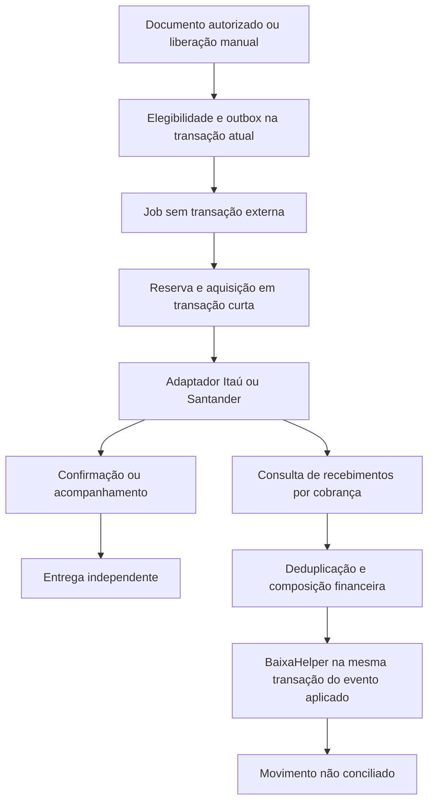

# Arquitetura

O modelo Sicoob forneceu a referência de fila na transação do título, reserva anterior ao HTTP e baixa nativa. A implementação é autônoma e usa `br.com.zaya.apiboletos`, sem classes de ZayaProd nem regras fixas de clientes.

## Componentes

- `domain`: configuração, título, cobrança, identidade, operação e pagamento.
- `ports`: contratos de registro, instrução, consulta, recebimento, documento, baixa e credenciais.
- `application`: seleção do adaptador, configuração e processamento.
- `banks`: HTTP com PATCH nativo e OAuth; DTOs e mapeamentos por banco.
- `persistence`: SQL parametrizado e repositório sem HTTP em transações.
- `sankhya`: fronteira JAPE/JTA, eventos, carregamento do financeiro e rotinas nativas.
- `services`: interfaces autenticadas e autorização por empresa.
- `jobs`: processamento a cada minuto, coleta a cada minuto respeitando cursor individual e recuperação a cada cinco minutos.
- `security`: AES-GCM vinculado à configuração, chave gerenciada e validação de certificado.
- `vc`: configuração e monitores via serviços; dicionário oferece consultas técnicas somente leitura.

## Estruturas persistidas

V1 cria `ZYCB_CFG`, `ZYCB_COB`, `ZYCB_OPER`, `ZYCB_RESERVA`, `ZYCB_CRED`, `ZYCB_REC`, `ZYCB_CURSOR`, `ZYCB_AUDIT`, `ZYCB_ACESSO`, `ZYCB_NUM` e `ZYCB_SCAN`. V2 cria índices de fila, ordem por cobrança e consultas por configuração. Estruturas próprias são criadas por DBScripts, com autoDDL desabilitado.

A identidade do título é global por NUFIN e geração. A reserva por NUFIN protege contra dois conectores do próprio produto. Isso não substitui a desativação de motores externos/CNAB que não participam desse registro. A configuração fixa sua empresa, conta, banco, contrato e ambiente; cobranças preservam um snapshot. As credenciais podem ser rotacionadas sem mudar a identidade bancária.

## Fronteiras transacionais

Eventos usam a conexão corrente e não confirmam a transação do documento. O worker usa transações autônomas curtas para aquisição, reserva e resultado; a chamada bancária acontece entre elas. Os serviços e jobs estão marcados como NotSupported para suspender transações EJB externas. A geração do PDF ocorre fora da transação de baixa/entrega.

`DHENVIO` é registrado antes de qualquer operação mutável. Após interrupção, uma operação com esse marcador vai para INCERTO. O processamento de instruções respeita a sequência por cobrança e o resultado das anteriores; uma falha de entrega não transforma registro em falha bancária.

A coleta consulta cada cobrança conhecida com janela recorrente; não importa automaticamente boletos externos nem avança uma data global que possa perder títulos antigos. O cursor de elegibilidade percorre também inaptos e retorna ao corte inicial ao concluir um ciclo.

## Segurança e acesso

O acesso administrativo inicial depende do SUP. Depois, `ZYCB_ACESSO` associa usuário, empresa e perfil. Os serviços verificam a empresa do objeto carregado, não apenas um identificador recebido do navegador. Credenciais são apenas de escrita, cifradas com AES-GCM e AAD por configuração. A chave não está na base, na AppKey ou na licença.

As consultas Dynaform técnicas devem ser restritas por acesso nativo Sankhya; não oferecem o mesmo isolamento por empresa da central. Seus campos são somente leitura e eventos bloqueiam CRUD genérico. Não expõem credenciais ou snapshots JSON.

## Erros e suporte

Estados de operação: PENDENTE, PROCESSANDO, AGUARDANDO, INCERTO, REJEITADO, CONCLUIDO e EXCECAO. Os monitores mostram códigos operacionais sem payload bancário ou dados de autenticação. Um resultado incerto exige consulta; não existe botão que force repetição de inclusão já enviada.

A conciliação de crédito permanece independente. Pagamentos parciais, excessivos, repetidos com valores diferentes, estornos ou recebimentos em cobranças canceladas geram divergência, sem estornar ou baixar automaticamente outro financeiro.
