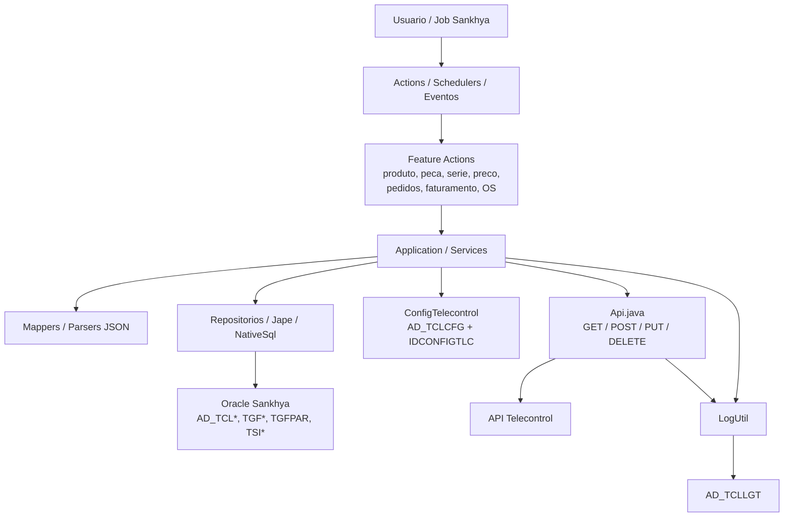
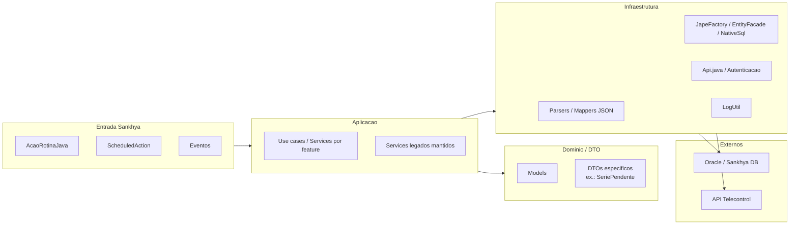
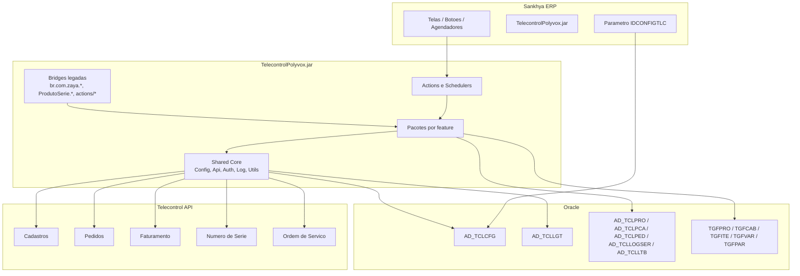
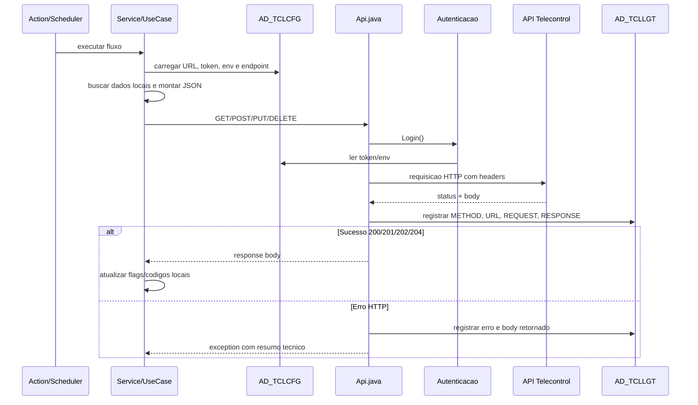
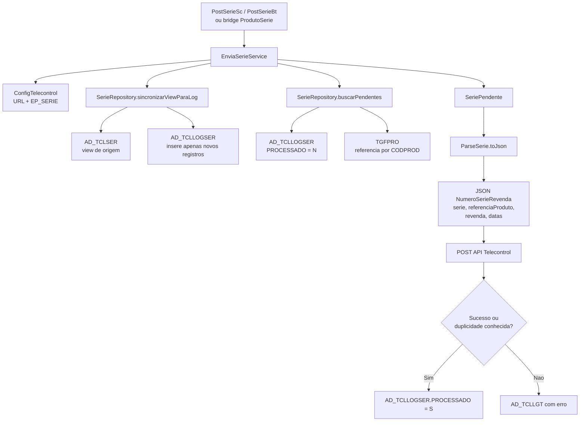
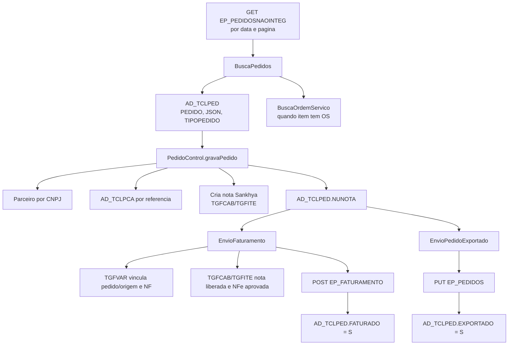
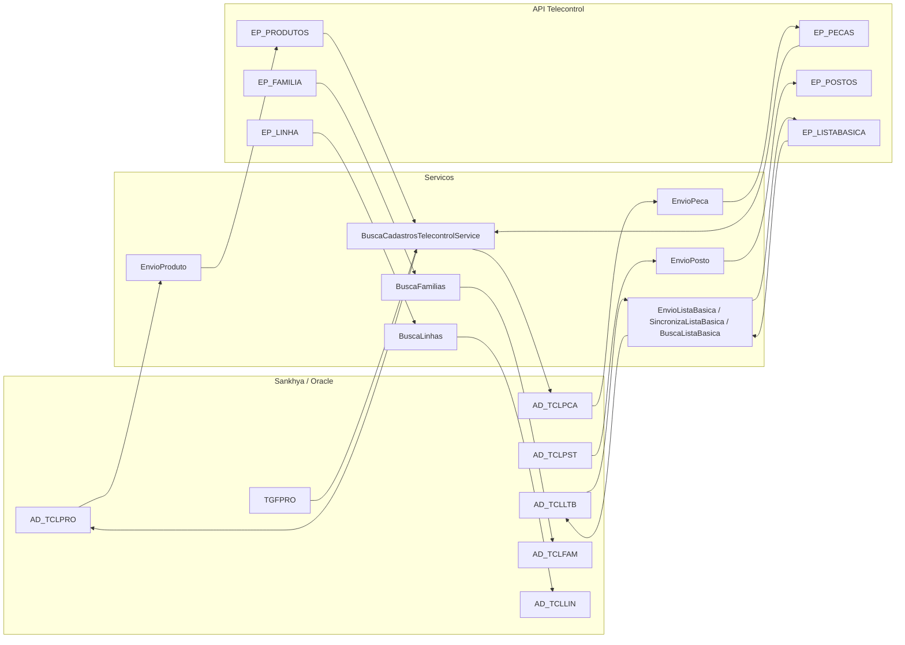
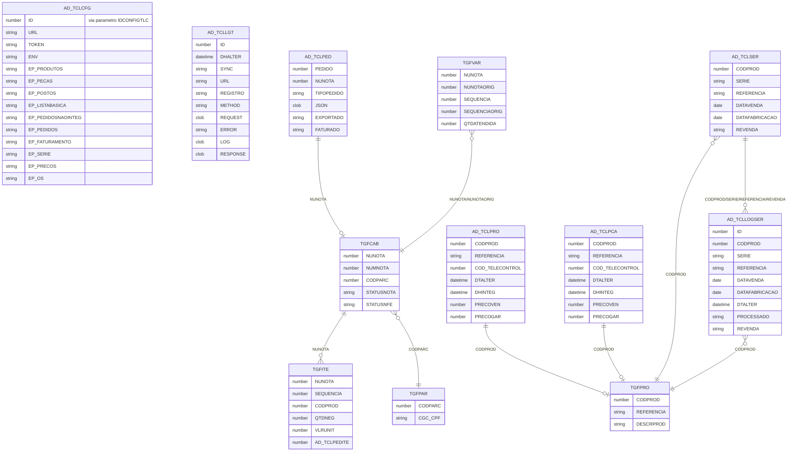

# Telecontrol - Visao Geral do Ecossistema

## Objetivo

Este documento desenha como o Telecontrol funciona hoje no projeto `PolyvoxTelecontrol`, considerando o pacote Java consolidado em:

```txt
C:\zy-tools\workspace\Polyvox\PolyvoxTelecontrol
```

A visao abaixo foi montada a partir do codigo-fonte atual e do contexto registrado em `/.ai/context`. Onde o codigo nao permite confirmar valores finais, a informacao foi marcada como **A confirmar**.

## Resumo Executivo

O Telecontrol e uma integracao Java executada dentro do Sankhya. O JAR expoe `Actions`, `Schedulers` e eventos que leem dados do banco Sankhya/Oracle, montam JSONs, chamam a API Telecontrol via HTTP e gravam retorno/erros em tabelas customizadas.

Principais caracteristicas atuais:

- Entrada pelo Sankhya via `AcaoRotinaJava`, `ScheduledAction` e eventos.
- Configuracao central em `AD_TCLCFG`, referenciada pelo parametro global `IDCONFIGTLC`.
- Cliente HTTP central em `br.zaya.telecontrol.shared.infrastructure.http.Api`.
- Log tecnico central em `AD_TCLLGT`.
- Dados locais de integracao em tabelas `AD_TCL*`.
- Pacotes novos por feature, mantendo bridges legadas para nao quebrar FQCNs cadastrados no Sankhya.

## Arquitetura Atual



## Camadas



## Modelo EAR / Componentes



## Requisicoes Mapeadas

Os endpoints finais sao montados com `AD_TCLCFG.URL + campo EP_*`. Os caminhos reais configurados no banco devem ser confirmados no ambiente.

| Fluxo | Origem local | Endpoint configurado | Metodo | Resultado local |
|---|---|---|---|---|
| Produto | `AD_TCLPRO` | `EP_PRODUTOS` | `POST` quando nao tem `COD_TELECONTROL`; `PUT /referencia/{REFERENCIA}` quando tem | Atualiza `COD_TELECONTROL` e `DHINTEG` |
| Peca | `AD_TCLPCA` | `EP_PECAS` | `POST` quando nao tem `COD_TELECONTROL`; `PUT /referencia/{REFERENCIA}` quando tem | Atualiza `COD_TELECONTROL` e `DHINTEG` |
| Posto | `AD_TCLPST` | `EP_POSTOS` | `POST` ou `PUT` conforme codigo Telecontrol local | Atualiza integracao local |
| Lista basica - envio local | `AD_TCLLTB` | `EP_LISTABASICA` | `POST`, `PUT` ou `DELETE por produto/peca` | Envia composicao local para a Telecontrol |
| Lista basica - busca API | `AD_TCLPRO.REFERENCIA` + API Telecontrol | `EP_LISTABASICA/referenciaProduto/{referencia}` | `GET` | Persiste retorno em `AD_TCLLTB`, resolvendo produto por `AD_TCLPRO.REFERENCIA` e peca por `AD_TCLPCA.REFERENCIA` |
| Lista basica - delete produto | `AD_TCLPRO.REFERENCIA` | `EP_LISTABASICA/referenciaProduto/{referencia}` | `DELETE` | Solicita exclusao da lista basica do produto na API Telecontrol |
| Familia | API Telecontrol | `EP_FAMILIA` | `GET` | Grava/atualiza `AD_TCLFAM` |
| Linha | API Telecontrol | `EP_LINHA` | `GET` | Grava/atualiza `AD_TCLLIN` |
| Pedidos nao integrados | API Telecontrol | `EP_PEDIDOSNAOINTEG` | `GET` paginado | Grava/atualiza `AD_TCLPED` com JSON do pedido |
| Pedido exportado | `AD_TCLPED` | `EP_PEDIDOS` | `PUT` | Marca `AD_TCLPED.EXPORTADO = 'S'` |
| Faturamento | `AD_TCLPED` + notas `TGFCAB/TGFITE/TGFVAR` | `EP_FATURAMENTO` | `POST` | Marca `AD_TCLPED.FATURADO = 'S'` |
| Serie com revenda | `AD_TCLSER` view + `AD_TCLLOGSER` + `TGFPRO` | `EP_SERIE` | `POST` | Sincroniza a view para `AD_TCLLOGSER` sem duplicar e marca `AD_TCLLOGSER.PROCESSADO = 'S'` em sucesso ou duplicidade conhecida |
| Preco | `AD_TCLPRO` / `AD_TCLPCA` + `SNK_PRECO` | `EP_PRECOS` | `POST` quando preco local nulo; `PUT /siglaTabela/{VEN/GAR}/pecaReferencia/{REFERENCIA}` quando ja existe | Atualiza `PRECOVEN` e/ou `PRECOGAR` |
| Ordem de servico | API Telecontrol | `EP_OS` ou `/os/osvisaogeral` | `GET` | Integra dados de OS e apoia documento/pedido |

## Fluxo das Requisicoes HTTP



## Fluxo de Serie



Observacoes importantes:

- `AD_TCLSER` e a view de origem das series.
- `AD_TCLLOGSER` e a fila/controle de processamento.
- `AD_STP_INC_AD_TCLLOGSER` nao e mais necessaria para o envio Java atual; o insert na `AD_TCLLOGSER` e feito pelo `SerieRepository`.
- A referencia enviada no payload prioriza `TGFPRO.REFERENCIA`; `AD_TCLLOGSER.REFERENCIA` e fallback.

## Fluxo de Pedidos e Faturamento



## Fluxo de Cadastros



## Modelo ER Simplificado



## Pacotes Principais

```txt
br.zaya.telecontrol
  actions/                     bridges antigas ainda usadas por metadata Sankhya
  produto/actions              actions reais de produto
  produto/application          casos de uso de produto
  produto/infrastructure       mappers de produto
  peca/actions                 actions reais de peca
  peca/application             casos de uso de peca
  serie/actions                PostSerieBt / PostSerieSc
  serie/application            EnviaSerieService
  serie/domain                 SeriePendente
  serie/infrastructure         SerieRepository / ParseSerie
  preco/actions                EnvioPrecosBt
  preco/application            EnvioPrecoService
  listabasica/actions          EnvioListaBasicaBt / SincronizaListaBasicaBt / BuscaListaBasicaBt / DeleteListaBasicaProdutoBt
  listabasica/application      EnvioListaBasicaService / SincronizaListaBasicaService / BuscaListaBasicaService
  pedidos/actions              BuscaPedidosBt / BuscaPedidosSc
  pedidos/application          BuscaPedidosService / EnvioPedidoExportadoService
  faturamento/actions          EnviaFaturamentoBt / EnviaFaturamentoSc
  faturamento/application      EnvioFaturamentoService
  ordemservico/actions         Busca/Sync OS
  osintegracao/actions         Actions e schedulers de integracao de OS
  osintegracao/application     Use cases e geracao documental
  shared/config                ConfigTelecontrol
  shared/infrastructure/http   Api / Autenticacao
  shared/utils                 LogUtil / ActionMessageUtil / LockManager
  services                     legado interno preservado
  parsers                      parsers legados preservados
  models                       modelos JSON

br.com.zaya.telecontrol        bridges de compatibilidade
ProdutoSerie                   bridges de compatibilidade da rotina antiga de serie
```

## Pontos de Melhoria Arquitetural

### Prioridade Alta

- Criar repositorios por feature para reduzir SQL/Jape direto dentro dos services legados.
- Migrar chamadas diretas ao `Api` para a interface `ITelecontrolApiClient`, como ja iniciado na parte de OS.
- Padronizar retorno das actions com `ActionMessageUtil` em todos os pontos de entrada.
- Confirmar e documentar FQCNs cadastrados no Sankhya antes de remover qualquer bridge.

### Prioridade Media

- Separar claramente `domain`, `application`, `infrastructure` para produto, peca, pedidos e faturamento, como ja foi iniciado em series.
- Criar DTOs de request/response especificos por endpoint para reduzir dependencia de JSON manual.
- Centralizar regra de atualizacao de flags (`DHINTEG`, `EXPORTADO`, `FATURADO`, `PROCESSADO`) em repositorios.
- Adicionar testes unitarios para mappers e testes de integracao simulando respostas da API.

### Prioridade Baixa

- Evoluir lock em memoria para lock transacional em banco quando houver multiplos nos executando schedulers.
- Versionar scripts DDL das tabelas `AD_TCL*`.
- Criar dashboard operacional sobre `AD_TCLLGT`.

## Pontos de Atencao

- `AD_TCLSER` faz parte do fluxo atual como view de origem.
- `AD_TCLLOGSER` e a fila atual de series e guarda controle por `PROCESSADO`.
- A procedure `AD_STP_INC_AD_TCLLOGSER` pode existir no banco, mas o Java atual faz o insert na `AD_TCLLOGSER` sem depender dela.
- O envio de series marca duplicidade conhecida da API como processada para evitar reenvio infinito.
- `ApagarLOGBt` executa limpeza de `AD_TCLLGT`; usar apenas com intencao explicita.
- As bridges legadas existem por compatibilidade, nao devem virar ponto de evolucao principal.

## A Confirmar

- Valores atuais de `AD_TCLCFG.EP_*` em homologacao/producao.
- FQCNs efetivamente cadastrados nos agendadores, botoes e eventos Sankhya.
- Se `TGFPRO.REFERENCIA` sempre deve prevalecer sobre `AD_TCLLOGSER.REFERENCIA`.
- Validar em homologacao se a view `AD_TCLSER` possui todos os campos usados pelo Java: `CODPROD`, `SERIE`, `REFERENCIA`, `DATAVENDA`, `DATAFABRICACAO` e `REVENDA`.
- Periodicidade oficial de cada scheduler.
- Estrutura completa das tabelas `AD_TCL*` em producao.
