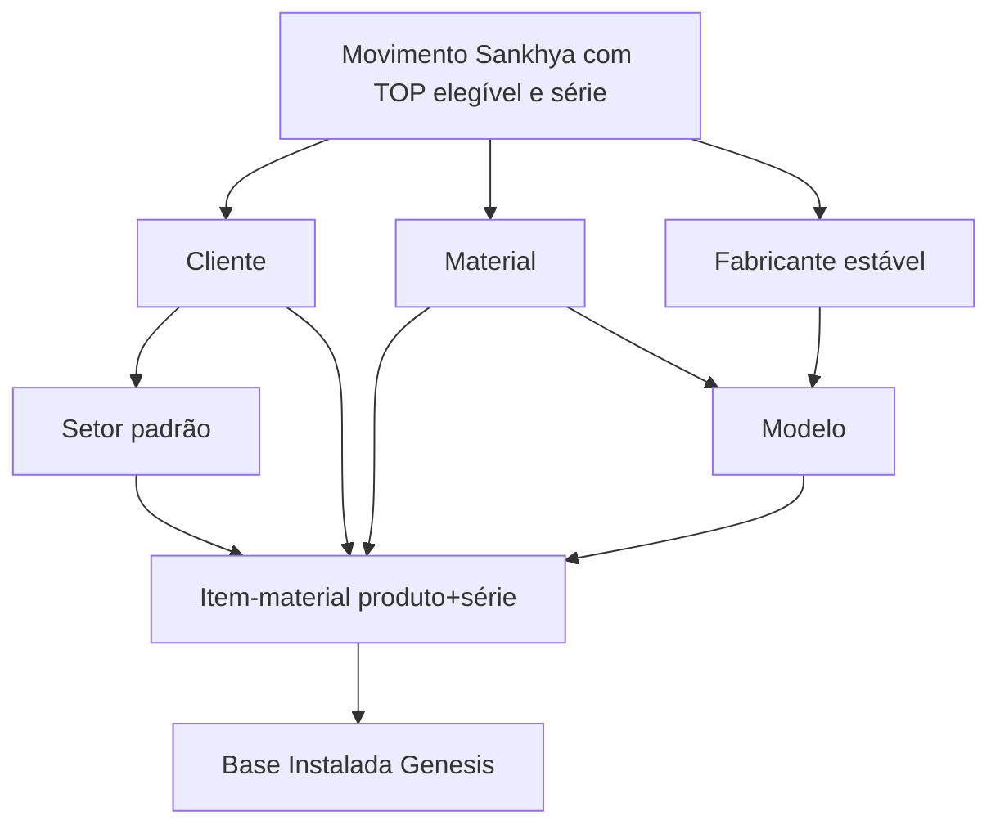
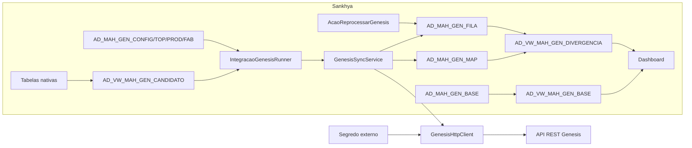
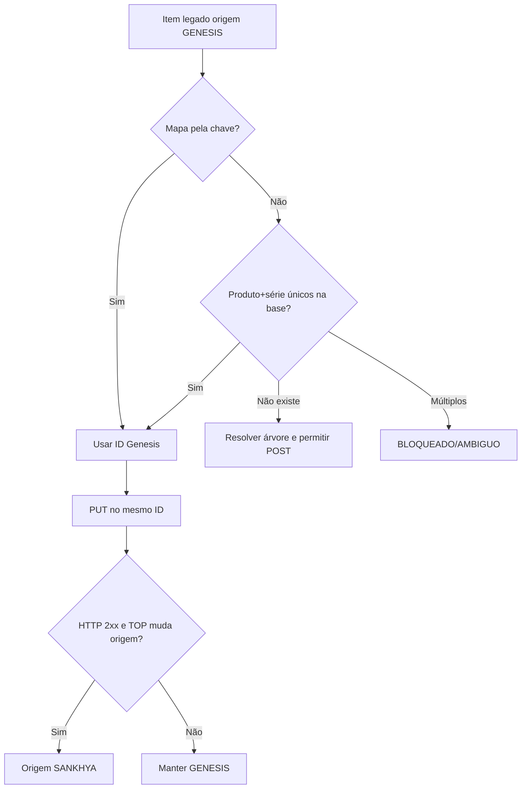

# IntPDD - Integração Sankhya x Genesis

> Atualização de 24/08/2026: as seções que citam `AD_MAH_GEN_CONFIG` e
> `AD_MAH_GEN_TOP` registram o desenho anterior. O código consolidado usa
> `AD_CENTPARAM` e `AD_CENTPARAMTOP`, `NUPAR=1`, conforme
> `implantacao-consolidada.md`. O destino final permanece `/itens-materiais/`.

## Base Instalada, sincronização cadastral e transição Protheus para Sankhya

| Identificação | Valor |
|---|---|
| Documento | `ZY-MAH-2026-GENESIS-INTPDD-002` |
| Documento anterior | `ZY-MAH-2026-GENESIS-INTPDD-001` |
| Escopo de referência | Definição de Escopo de Customização nº 2764 |
| Versão | v0.9 - as built para homologação |
| Data | 23 de agosto de 2026 |
| Responsável técnico | Zaya IT - validação interna pendente |
| Tipo | Especificação técnica de integração e desenvolvimento |
| Tecnologia | Java 8, Sankhya MGE 4.35, Oracle, JSP/HTML5 e API REST Genesis |
| Status | Implementado localmente; pendente de implantação, contrato autenticado e homologação |
| Classificação | Uso interno e repasse técnico |

> Este IntPDD documenta o software desenvolvido até a data indicada. A versão somente poderá ser promovida a “Aprovada” após confirmação das fixtures da API, execução no banco do cliente, carga reconciliada e homologação funcional.

## 1. Objetivo

Especificar tecnicamente a integração que permitirá ao Sankhya assumir do Protheus a manutenção da Base Instalada da MA Hospitalar na Genesis.

O documento sustenta:

- arquitetura implementada;
- modelo de dados Oracle;
- componentes Java e Sankhya;
- árvore de dependências cadastrais;
- contratos internos e payloads REST;
- idempotência, conciliação, retry e segurança;
- carga legada e transição de origem;
- dashboard e reprocessamento;
- testes, homologação, deploy, cutover e rollback;
- limites e dependências externas da release.

## 2. Relação com o IntPDD anterior

O `ZY-MAH-2026-GENESIS-INTPDD-001` especificava movimentos de estoque por série, consolidados em uma view e enviados por POST ao recurso `/estoques/`.

O processo esclarecido posteriormente alterou o objeto principal:

| IntPDD-001 | IntPDD-002 |
|---|---|
| movimento de estoque | equipamento individual da Base Instalada |
| identidade por nota/item/série | identidade por produto+série |
| POST em `/estoques/` | GET/POST/PUT em seis recursos |
| parceiro/produto como dados do movimento | cliente/material/modelo como cadastros predecessores |
| uma view orientada ao histórico | candidato de último estado + espelho legado |
| controle por movimento | mapa de IDs + outbox por entidade/chave/hash |
| sem migração formal | carga legada e cutover Protheus -> Sankhya |

Este documento substitui o desenho técnico do IntPDD-001 para o fluxo da Base Instalada. O fluxo de peças, serviços, preços e estoques comerciais não foi incorporado e exige especificação própria.

## 3. Fontes e premissas

### 3.1 Fontes

- escopo nº 2764;
- IntPDD `ZY-MAH-2026-GENESIS-INTPDD-001`;
- transcrição do alinhamento técnico com o cliente;
- projeto Sankhya anterior orientado a estoque;
- rotinas Protheus `GENFWS`, `GENM010`, `GENM020`, `genm030`, `genm040`, `genm050`, `GENM060` e `GENM070`;
- código e scripts presentes no repositório `ma-hospitalar`.

### 3.2 Hierarquia das evidências

1. contrato autenticado e comportamento observado na homologação Genesis;
2. processo formalmente aprovado com o cliente;
3. código Protheus como evidência do funcionamento anterior;
4. escopo e IntPDD anterior como linha de base histórica;
5. implementação atual como evidência do que está construído, não como validação automática da regra.

### 3.3 Premissas implementadas

- Oracle e Sankhya 4.35;
- Java 8;
- um único projeto e um único `MAHospitalar.jar`;
- um setor padrão por cliente;
- item-material identificado inicialmente por produto+série;
- Base Instalada legada espelhada sem implantação de saldo;
- códigos externos legados preservados na v1;
- carga legada por script pontual;
- nenhuma chamada externa em evento de persistência;
- release única com gates internos;
- cutover alvo em 5 de outubro de 2026, condicionado à aprovação.

## 4. Escopo técnico

### 4.1 Incluído

- configuração por ambiente;
- provedor externo de segredo;
- sincronização de clientes;
- criação de setor padrão;
- sincronização de materiais;
- cadastro estável e sincronização de fabricantes;
- sincronização de modelos;
- criação e atualização de itens-materiais;
- persistência de IDs e códigos externos;
- conciliação de legado;
- origem `GENESIS` e `SANKHYA`;
- outbox, lock, retry e reprocessamento;
- views de candidato, base unificada e divergências;
- carga inicial e delta de cutover;
- dashboard operacional;
- testes automatizados e smoke opt-in;
- documentação de implantação, homologação e rollback.

### 4.2 Fora da v1

- peças;
- serviços;
- preços;
- fluxo equivalente ao `GENM070`;
- reimplementação integral do endpoint `/estoques/`;
- alteração ou implantação de saldo em `TGFEST`;
- troca massiva dos códigos externos legados;
- resolução automática de ambiguidade;
- armazenamento de token no banco ou JAR.

## 5. Visão funcional



O item-material não pode ser criado corretamente enquanto os IDs de cliente, setor, material e modelo não forem conhecidos. O modelo, por sua vez, depende de material e fabricante.

## 6. Arquitetura

### 6.1 Componentes



### 6.2 Princípios

- integração assíncrona em ação agendada;
- reserva no banco antes da chamada HTTP;
- chamada HTTP fora da transação de persistência do documento Sankhya;
- estado técnico persistido para retomada;
- idempotência local por entidade, chave e hash;
- prevenção de POST quando existir correspondência única;
- bloqueio de correspondência múltipla;
- segredo fora do artefato;
- rastreabilidade sem exclusão física durante rollback.

## 7. Estrutura de classes

| Pacote/classe | Responsabilidade |
|---|---|
| `schedule.IntegracaoGenesisScheduleAction` | entry point da agenda Sankhya |
| `service.IntegracaoGenesisRunner` | valida gates, segredo, TOPs, locks e candidatos |
| `service.GenesisSyncService` | orquestra árvore, mapa, fila e API |
| `service.PayloadGenesisFactory` | cria DTO, JSON canônico, chave e hash |
| `service.RetryPolicyGenesis` | define retry e esgotamento de tentativas |
| `client.GenesisApiClient` | contrato interno das operações REST |
| `client.GenesisHttpClient` | GET/POST/PUT, token, timeout e classificação HTTP |
| `client.GenesisApiResult` | retorno tipado e sanitizado |
| `config.ParametrosGenesis` | configuração validada e gates |
| `config.GenesisSecretProvider` | contrato para leitura do segredo |
| `config.EnvironmentGenesisSecretProvider` | propriedade segura e fallback controlado de teste |
| `repository.ConfigGenesisRepository` | configuração e validação de TOPs |
| `repository.CandidatoGenesisRepository` | leitura da view de candidatos |
| `repository.MapGenesisRepository` | IDs, códigos externos, origem e legado |
| `repository.FilaGenesisRepository` | outbox, lock, retry e ação manual |
| `action.AcaoReprocessarGenesis` | libera registros corrigidos |
| `util.GenesisHash` | SHA-256 do JSON canônico |
| `util.GenesisSanitizer` | máscara e truncamento de retornos persistidos |

## 8. Dados Sankhya e Oracle

### 8.1 Tabelas nativas consultadas

| Tabela | Uso |
|---|---|
| `TGFCAB` | empresa, parceiro, TOP, datas e situação da nota |
| `TGFITE` | produto, valor, local e sequência |
| `TGFSER` | série, garantia e status vigente do equipamento |
| `TGFPRO` | produto, grupo, marca, Anvisa e situação |
| `TGFGRU` | material/grupo tecnológico |
| `TGFPAR` | cliente, documento, contato e endereço |
| `TSIEND`, `TSIBAI`, `TSICID`, `TSIUFS` | endereço do cliente |
| `TGFLOC` | descrição do local |

`TGFEST` não é fonte nem destino da carga legada da Base Instalada.

### 8.2 Campos adicionais em série

| Campo | Tipo | Finalidade |
|---|---|---|
| `TGFSER.AD_GARANTIA` | `NUMBER(5)` | garantia em meses por equipamento/série |
| `TGFSER.AD_STATUSEST` | `VARCHAR2(1)` | status do equipamento por série |

Os domínios definitivos de status devem ser confirmados com o cliente antes da aprovação funcional.

### 8.3 `AD_MAH_GEN_CONFIG`

| Coluna | Função |
|---|---|
| `AMBIENTE` | `HML` ou `PROD` |
| `BASEURL` | URL por ambiente, sem token |
| `ATIVO` | chave geral de execução |
| `MODOSIMULACAO` | gera fila/payload sem API |
| `CONNTIMEOUTMS`, `READTIMEOUTMS` | timeouts HTTP |
| `MAXTENTATIVAS` | limite de retry |
| `TAMANHOLOTE` | quantidade máxima de candidatos |
| `UNIDADEEPOCH` | `S`, `MS` ou `US` confirmada |
| `CONTRATOAPROVADO` | gate do contrato API |
| `EXTRACAOAPROVADA` | gate da extração oficial |
| `TOPSAPROVADAS` | gate das regras operacionais |
| `RECONCILIADO` | gate da conciliação da base |

A linha inicial é criada inativa, em simulação e com todos os gates em `N`.

### 8.4 `AD_MAH_GEN_TOP`

| Coluna | Função |
|---|---|
| `CODTIPOPER` | TOP elegível única |
| `TIPOEVENTO` | entrada, saída, remessa, retorno, ajuste ou implantação |
| `SITUACAOGENESIS` | situação enviada ao item-material |
| `MUDAORIGEM` | autoriza `GENESIS` -> `SANKHYA` após sucesso |
| `ATIVO` | habilita a regra |

### 8.5 `AD_MAH_GEN_FAB`

Cadastro estável de fabricante, com código próprio, nome, códigos externos, eventual ID Genesis, status e ativação. Evita depender da edição livre de `TGFPRO.MARCA`.

### 8.6 `AD_MAH_GEN_PROD`

Vincula produto a fabricante e registra grau de risco, status padrão e ativação para o modelo Genesis.

### 8.7 `AD_MAH_GEN_MAP`

| Grupo | Colunas |
|---|---|
| Identidade | `TIPOENTIDADE`, `CHAVESNK` |
| Genesis | `IDGENESIS`, `CODEXTLEGADO`, `CODEXTATUAL` |
| Estado | `ORIGEM`, `STATUSCONCILIACAO`, `HASHULTIMO` |
| Auditoria | criação, alteração e sincronização |

Restrições impedem duas chaves para a mesma entidade, dois códigos externos atuais ou dois mapas com o mesmo ID Genesis dentro da entidade.

### 8.8 `AD_MAH_GEN_BASE`

Mantém o espelho do item legado: IDs da árvore Genesis, chave Sankhya quando conciliada, parceiro, grupo, produto, série, código externo, situação, garantia, marca, datas, valor, origem e status.

### 8.9 `AD_MAH_GEN_FILA`

| Grupo | Colunas |
|---|---|
| Identidade | entidade, chave e hash |
| Operação | GET/POST/PUT/UPSERT e prioridade |
| Dependência | fila predecessora e mapa |
| Conteúdo | payload JSON |
| Retry | tentativas e próxima tentativa |
| Concorrência | lock e data do lock |
| Retorno | HTTP, erro sanitizado e ID retornado |
| Auditoria | criação, alteração e envio |

## 9. Views

### 9.1 `AD_VW_MAH_GEN_CANDIDATO`

Finalidade: obter o último estado Sankhya por produto+série, e não cada nota histórica.

Regras principais:

- somente série preenchida;
- somente nota liberada;
- somente TOP ativa;
- `ROW_NUMBER()` por produto+série, ordenado por data/nota/item decrescente;
- cliente e endereços consolidados;
- material pelo grupo;
- fabricante pela configuração estável;
- chaves e códigos externos Sankhya derivados.

### 9.2 `AD_VW_MAH_GEN_BASE`

Expõe uma visão unificada:

- equipamentos ainda de origem Genesis que não foram assumidos;
- equipamentos cujo estado vigente vem do Sankhya.

### 9.3 `AD_VW_MAH_GEN_DIVERGENCIA`

Expõe erros de fila, mapas pendentes/ambíguos/com erro e produto sem fabricante.

## 10. Identidade e idempotência

### 10.1 Chaves

| Entidade | Chave |
|---|---|
| Cliente | `CODPARC` |
| Setor | `CODPARC\|PADRAO` |
| Material | `CODGRUPOPROD` |
| Fabricante | código de `AD_MAH_GEN_FAB` |
| Modelo | `CODPROD` |
| Item-material | `CODPROD\|SERIE_NORMALIZADA` |

### 10.2 Hash

O DTO é serializado de forma determinística e recebe SHA-256. A unicidade da fila usa entidade+chave+hash. Quando o mapa já contém o mesmo hash e um ID Genesis, não é feita nova chamada.

### 10.3 Códigos externos

- legado: manter `CODEXTATUAL` importado;
- novo: gerar prefixo `SNK-*` estável;
- nunca substituir o legado apenas para uniformizar nomenclatura;
- nunca usar número da nota como identidade do item-material.

## 11. Contrato da API Genesis

### 11.1 Operações internas

```java
GenesisApiResult buscarPorCodigoExterno(TipoEntidade tipo, String codigoExterno)
GenesisApiResult criar(TipoEntidade tipo, Object payload)
GenesisApiResult atualizar(TipoEntidade tipo, String idGenesis, Object payload)
```

### 11.2 Recursos

| Entidade | Recurso | Operações |
|---|---|---|
| Cliente | `/clientes/` | GET por código, POST e PUT por ID |
| Setor | `/setores/` | GET por código, POST e PUT por ID |
| Material | `/materiais/` | GET por código, POST e PUT por ID |
| Fabricante | `/empresas/` | GET por código, POST e PUT por ID |
| Modelo | `/modelos/` | GET por código, POST e PUT por ID |
| Item-material | `/itens-materiais/` | GET por código, POST e PUT por ID |

Base URL e eventual prefixo, como `/api/v1`, pertencem à configuração confirmada por ambiente.

### 11.3 Cabeçalhos

```http
Accept: application/json
Content-Type: application/json; charset=UTF-8
token: {SEGREDO_EXTERNO}
```

O header `token` foi comprovado no `GENFWS` do Protheus. Deve ser confirmado novamente nas fixtures autenticadas.

### 11.4 Payload de cliente

| Campo Genesis | Origem inicial |
|---|---|
| `codigoExterno` | mapa ou `SNK-CLI-{CODPARC}` |
| `cnpj`/`cpf` | `TGFPAR.CGC_CPF`, somente dígitos |
| `nomeFantasia` | `TGFPAR.NOMEPARC` |
| `razaoSocial` | `TGFPAR.RAZAOSOCIAL` |
| `status` | parceiro ativo/inativo |
| `email`, `telefone`, `cep` | parceiro |
| `endereco`, `enderecoBairro`, `enderecoCidade`, `enderecoUF` | tabelas de endereço |

### 11.5 Payload de setor

| Campo | Origem |
|---|---|
| `codigoExterno` | mapa ou `SNK-SET-{CODPARC}` |
| `nome` | `PADRAO` na v1 |
| `idCliente` | ID do cliente conciliado |

### 11.6 Payload de material

| Campo | Origem |
|---|---|
| `codigoExterno` | mapa ou `SNK-MAT-{CODGRUPOPROD}` |
| `nome` | descrição do grupo |
| `status` | situação do produto |
| `grauRisco` | `AD_MAH_GEN_PROD.GRAURISCO` |

### 11.7 Payload de fabricante

| Campo | Origem |
|---|---|
| `codigoExterno` | cadastro/mapa estável |
| `nomeFantasia`, `razaoSocial` | `AD_MAH_GEN_FAB.NOME` |
| `cnpj` | pendente de dado/contrato |
| `status` | configuração |
| `fabricante`, `fornecedor` | `true` na regra inicial derivada do Protheus |

### 11.8 Payload de modelo

| Campo | Origem |
|---|---|
| `codigoExterno` | mapa ou `SNK-MOD-{CODPROD}` |
| `nome` | descrição do produto |
| `idEmpresaFabricante` | fabricante conciliado |
| `idMaterial` | material conciliado |
| `status` | situação do produto |
| `nranvisa` | cadastro do produto |

### 11.9 Payload de item-material

| Campo | Origem |
|---|---|
| `idCliente` | cliente conciliado |
| `idSetor` | setor conciliado |
| `idModelo` | modelo conciliado |
| `idMaterial` | material conciliado |
| `nserie` | série normalizada |
| `dataAquisicao`, `dataInstalacao` | data do movimento convertida para epoch |
| `valorUnitario` | item da nota |
| `situacao` | configuração da TOP |
| `garantia` | garantia em meses por série |
| `marca` | fabricante ou marca de fallback |
| `codigoExterno` | mapa ou `SNK-ITEM-{CODPROD}-{SERIE}` |
| `outros` | origem operacional e evento |

### 11.10 Pontos contratuais ainda não aprovados

- prefixo exato da URL;
- obrigatoriedade e nulabilidade;
- maiúsculas/minúsculas dos campos;
- domínios de status, risco e situação;
- unidade epoch;
- formato de ID;
- paginação e estrutura de GET;
- retorno de POST/PUT;
- rate limit;
- tamanho máximo de campos;
- tratamento oficial de conflito.

## 12. Fluxo da ação agendada

```text
1. Abrir sessão JDBC e desabilitar autocommit.
2. Carregar configuração ID 1.
3. Exigir ATIVO, URL, timeouts, lote, epoch e quatro gates.
4. Exigir pelo menos uma TOP ativa.
5. Exigir token do provedor externo.
6. Recuperar locks expirados e confirmar a recuperação.
7. Buscar candidatos até TAMANHOLOTE.
8. Para cada candidato, executar a árvore.
9. Para cada entidade:
   9.1 consultar mapa;
   9.2 no item, procurar legado subsidiariamente por produto+série;
   9.3 preservar código externo legado;
   9.4 gerar JSON e hash;
   9.5 enfileirar;
   9.6 se hash já enviado, encerrar sem API;
   9.7 se simulação, marcar SIMULADO;
   9.8 reservar com lock e confirmar no banco;
   9.9 executar PUT quando ID for conhecido;
   9.10 senão executar GET, seguido de POST apenas se ausente;
   9.11 persistir retorno, ID e hash;
   9.12 liberar o próximo nível.
10. Interromper lote em 401/403.
11. Isolar outros erros por candidato e registrar diagnóstico.
```

## 13. Legado e origem

### 13.1 Carga

A extração oficial deve popular `AD_MAH_GEN_MAP` e `AD_MAH_GEN_BASE` por `MERGE`. O script com dados reais não será versionado.

Validações críticas:

- entidade/chave duplicada;
- ID Genesis duplicado por entidade;
- produto+série ambíguo;
- referências órfãs;
- código externo ausente;
- quantidade por entidade antes/depois;
- inexistência de DML contra `TGFEST`.

### 13.2 Primeira movimentação Sankhya



Não atualizar a origem antes da confirmação da Genesis.

## 14. Concorrência e retomada

- a fila é única por entidade+chave+hash;
- a reserva muda status para `PROCESSANDO` e grava UUID/data;
- dependência precisa estar `ENVIADO`, `SIMULADO` ou `IGNORADO`;
- lock expirado volta para `REPROCESSAR`;
- a reserva é confirmada antes da chamada HTTP;
- após queda, o registro pode ser retomado sem novo POST quando o mapa/hash indicar sucesso conhecido;
- em timeout após POST sem resposta conclusiva, o próximo ciclo deve reconciliar por GET antes de criar novamente.

## 15. Erros e retry

| Evento | Classificação | Estado/Ação |
|---|---|---|
| `2xx` | sucesso | ID/hash conciliados; `ENVIADO` |
| GET `404` | ausente | POST permitido |
| GET vazio | ausente | POST permitido |
| GET múltiplo | conflito | bloquear; não escolher ID |
| `400/422` | funcional | `ERRO_FUNCIONAL` |
| `401/403` | autenticação | `BLOQUEADO`; interromper lote |
| `409` | conflito | reconciliar; bloquear se persistir |
| `408/429/5xx` | transitório | backoff exponencial |
| timeout/socket | transitório | backoff exponencial |
| tentativas esgotadas | funcional operacional | parar retry automático |
| resposta de sucesso sem ID | contrato inválido | erro funcional; não conciliar |

Erros funcionais de um candidato não devem interromper candidatos independentes. Falha de autenticação é global e interrompe o lote.

## 16. Segurança

### 16.1 Segredo

Interface: `GenesisSecretProvider`.

Produção lê `mah.genesis.token` como propriedade protegida do processo. Variável de ambiente só é aceita em testes explicitamente habilitados.

### 16.2 Sanitização

- token/authorization mascarados;
- CPF/CNPJ mascarados em corpos persistidos como erro;
- corpo limitado;
- segredo nunca incluído no payload, banco, dashboard ou mensagem de exceção.

### 16.3 Falha fechada

A execução é recusada quando:

- integração está inativa;
- URL não foi configurada;
- epoch não foi confirmado;
- timeout/tentativa/lote é inválido;
- um dos quatro gates está pendente;
- não existe TOP ativa;
- segredo não está disponível.

## 17. Dashboard e operação manual

### 17.1 Dashboard

Recurso: `webapp/genesis/index.jsp`.

Apresenta:

- totais por status;
- totais por origem;
- entidade e chave;
- ID Genesis e código externo;
- conciliação e hash;
- dependência;
- tentativas e HTTP;
- erro sanitizado;
- último envio e alteração;
- divergências.

### 17.2 Ação de reprocessamento

Classe: `br.com.zaya.mahospitalar.genesis.action.AcaoReprocessarGenesis`.

Somente seleciona `ERRO_FUNCIONAL`, `REPROCESSAR` e `BLOQUEADO`. Registros enviados não são reenviados pela ação sem mudança de hash.

## 18. Metadados e pacote

### 18.1 Metadados

- `metadata/metadata_mah_genesis.xml`;
- `metadata/dicionario-genesis.xml`;
- extensões de `TGFSER`.

As telas adicionais expõem configuração, TOPs, fabricantes, produtos, mapa, base e fila.

### 18.2 Build

```bash
./gradlew clean test genesisPackage
```

Saída:

```text
build/genesis-package/MAHospitalar-Genesis.zip
```

Conteúdo:

- mesmo `MAHospitalar.jar` do projeto;
- SQL Genesis;
- metadados;
- documentação;
- recursos do dashboard.

A tarefa do preço dinâmico continua disponível e seus testes devem permanecer aprovados.

## 19. Deploy

Ordem:

1. backup dos objetos e metadados adicionais;
2. executar `sql/genesis/00_schema.sql`;
3. executar `sql/genesis/01_views.sql`;
4. importar metadados Genesis;
5. publicar `MAHospitalar.jar`;
6. cadastrar `IntegracaoGenesisScheduleAction`;
7. cadastrar `AcaoReprocessarGenesis` na tela da fila;
8. publicar dashboard;
9. preencher configurações mantendo `ATIVO='N'` e simulação ativa;
10. cadastrar fabricantes, produtos e TOPs;
11. provisionar segredo;
12. carregar legado;
13. executar validações e aprovar os quatro insumos/gates;
14. executar dry-run mantendo simulação ativa;
15. homologar e obter autorização de go-live antes da ativação real.

## 20. Estratégia de testes

### 20.1 Automatizados

- DTOs e serialização;
- chaves, série, códigos externos, hash e epoch;
- preservação do legado;
- dependências e prioridade;
- GET -> POST;
- GET/ID -> PUT;
- lista vazia e ambígua;
- `400`, `401`, `404`, `409`, `429`, timeout e `5xx`;
- retry e limite;
- sanitização;
- contrato dos scripts/metadados/pacote;
- ausência de DML em `TGFEST`;
- regressão do preço dinâmico.

### 20.2 Smoke

Smoke real fica desabilitado por padrão. A versão atual contém uma classe read-only de busca de cliente, porém a tarefa Gradle `smokeTest` foi verificada como `NO-SOURCE` em 23/08/2026. Antes do uso, ela deve receber os diretórios e o classpath do source set de testes e produzir relatório JUnit. Escritas exigem flag adicional, massa controlada e autorização.

### 20.3 Homologação funcional mínima

1. cliente novo e existente;
2. setor padrão;
3. material, fabricante e modelo novos/existentes;
4. item-material novo;
5. item legado atualizado sem duplicidade;
6. legado sem nota no espelho;
7. origem alterada somente após PUT;
8. TOPs de entrada, saída, remessa e retorno;
9. ambiguidade bloqueada;
10. correção e reprocessamento;
11. replay idempotente;
12. dashboard conciliado.

## 21. Critérios de aceite

### 21.1 Técnicos

- build Java 8 aprovado;
- testes automatizados sem regressão;
- scripts idempotentes executados no Oracle do cliente;
- views conferidas com casos reais;
- JAR publicado sem dependência concorrente;
- segredo externo e rotacionado;
- dashboard coerente;
- fila recuperável após falha;
- nenhum DML em `TGFEST` pela carga;
- ausência de duplicidade após replay.

### 21.2 Funcionais

- árvore criada/atualizada conforme contrato;
- item novo integrado;
- item legado preserva ID;
- equipamento sem nota continua visível;
- origem respeita a primeira movimentação aprovada;
- TOPs geram situações corretas;
- cliente aprova contagens e vínculos.

### 21.3 Gates formais

- `CONTRATOAPROVADO='S'`;
- `EXTRACAOAPROVADA='S'`;
- `TOPSAPROVADAS='S'`;
- `RECONCILIADO='S'`.

## 22. Cutover

1. publicar release desativada;
2. carga inicial e reconciliação;
3. aprovar contrato, extração, TOPs e reconciliação nos quatro gates;
4. executar dry-run e homologação integral mantendo simulação ativa;
5. obter autorização formal de go-live;
6. congelar jobs Protheus;
7. extrair/carregar delta final;
8. comparar totais por entidade, IDs e ambiguidades;
9. alterar `MODOSIMULACAO='N'`;
10. ativar agenda e monitorar intensivamente.

A data alvo de 5 de outubro de 2026 depende desses passos e deve ser replanejada formalmente se qualquer gate permanecer pendente.

## 23. Rollback

- desativar `AD_MAH_GEN_CONFIG.ATIVO`;
- interromper agenda;
- reativar Protheus temporariamente somente quando aprovado;
- preservar mapa, fila e base;
- não apagar IDs, hashes ou histórico;
- reconciliar a janela antes de retomar.

## 24. Rastreabilidade requisito x implementação

| Requisito | Implementação | Evidência |
|---|---|---|
| Seis entidades | enum, DTOs e builders | pacote `genesis/domain`, `dto`, `service` |
| GET/POST/PUT | cliente tipado | `GenesisApiClient`/`GenesisHttpClient` |
| IDs Genesis | mapa | `AD_MAH_GEN_MAP` |
| Legado sem nota | espelho | `AD_MAH_GEN_BASE`/view base |
| Último estado por série | view candidato | `AD_VW_MAH_GEN_CANDIDATO` |
| Não duplicar nota histórica | partição produto+série | `ROW_NUMBER()` na view |
| Idempotência | mapa, fila e hash | unicidades + SHA-256 |
| Dependências | orquestração e fila | `GenesisSyncService`/`IDDEPENDENCIA` |
| Retry | política e próxima tentativa | `RetryPolicyGenesis`/fila |
| Concorrência | lock | `LOCKID`/`DHLOCK` |
| Origem | mapa/base | `ORIGEM` + regra TOP |
| Ambiguidade | bloqueio | mapa/divergência |
| Segurança | provedor e sanitização | `GenesisSecretProvider`/`GenesisSanitizer` |
| Reprocessamento | ação manual | `AcaoReprocessarGenesis` |
| Monitoramento | dashboard/views | `webapp/genesis` |
| Carga pontual | template transacional | `02_carga_legado_template.sql` |
| Sem saldo fiscal | ausência de DML | scripts/teste contratual |
| Gates de release | flags fechadas | `AD_MAH_GEN_CONFIG`/runner |

## 25. Dependências e pendências

| Item | Responsável esperado | Estado |
|---|---|---|
| Fixtures autenticadas dos seis endpoints | Genesis + Zaya | Pendente |
| Extração oficial por entidade | Genesis/MA Hospitalar | Pendente |
| TOPs e situações definitivas | MA Hospitalar + Zaya | Pendente |
| Mapeamento fabricante/produto | MA Hospitalar | Pendente |
| Unidade epoch e domínios | Genesis | Pendente |
| URL e token rotacionado de HML | Genesis/MA Hospitalar | Pendente |
| Validação física das views | Zaya no ambiente cliente | Pendente |
| Publicação do dashboard | Zaya | Pendente |
| Homologação integral | MA Hospitalar + Genesis + Zaya | Pendente |
| Aprovação de cutover | Todos os envolvidos | Pendente |

## 26. Riscos residuais

| Risco | Mitigação |
|---|---|
| contrato real divergir dos DTOs | gates + fixtures + smoke |
| `smokeTest` não executar classes | corrigir `testClassesDirs`/`classpath` e exigir relatório JUnit |
| parceiro sem documento falhar antes da fila | validar obrigatórios antes do builder e persistir erro funcional rastreável |
| série não ser globalmente única por produto | carga detecta ambiguidade; decisão funcional necessária |
| código externo legado incompleto | reconciliação antes da ativação |
| timeout após criação | GET antes de novo POST |
| campo instável gerar PUT recorrente | JSON determinístico, hash e análise do payload |
| dois processadores simultâneos | reserva atômica e lock expirável |
| desligamento prematuro do Protheus | cutover com congelamento e delta |
| vazamento de segredo | provedor externo e sanitização |
| alteração de saldo | carga isolada e teste sem DML em `TGFEST` |
| regressão do preço dinâmico | mesmo build com testes preservados |

## 27. Controle do documento

| Versão | Data | Autor/Responsável | Alteração |
|---|---|---|---|
| v0.9 | 23/08/2026 | Zaya IT - validação interna pendente | Emissão as built da Base Instalada, substituindo o fluxo técnico de estoque do IntPDD-001 |

### Aprovações necessárias

| Papel | Nome | Data | Situação |
|---|---|---|---|
| Responsável técnico Zaya | A preencher |  | Pendente |
| Desenvolvedor responsável | A preencher |  | Pendente |
| Responsável MA Hospitalar | A preencher |  | Pendente |
| Responsável Genesis | A preencher |  | Pendente |

## 28. Referências do repositório

- `docs/genesis/repasse-tecnico-integracao-genesis.md`;
- `docs/genesis/arquitetura.md`;
- `docs/genesis/configuracao.md`;
- `docs/genesis/carga-legado.md`;
- `docs/genesis/homologacao-cutover.md`;
- `docs/justificativa-ajuste-escopo-integracao-genesis.md`;
- `sql/genesis/00_schema.sql`;
- `sql/genesis/01_views.sql`;
- `sql/genesis/02_carga_legado_template.sql`;
- `sql/genesis/03_validacao.sql`;
- `metadata/metadata_mah_genesis.xml`;
- `webapp/genesis/index.jsp`;
- `src/br/com/zaya/mahospitalar/genesis`;
- `test/br/com/zaya/mahospitalar/genesis`.
