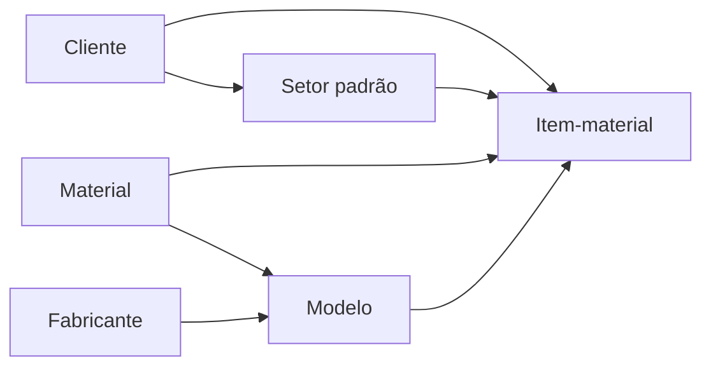
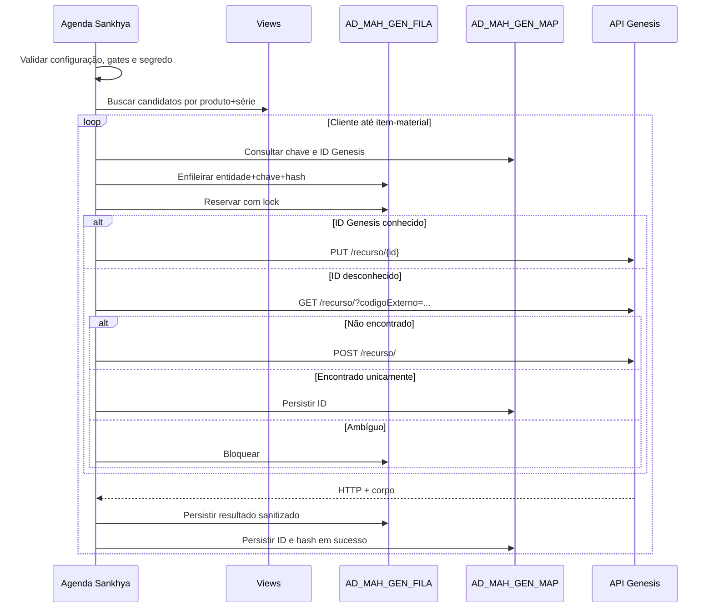

# Repasse técnico e operacional - Integração Sankhya x Genesis

> Atualização de 24/08/2026: configuração e TOPs foram unificadas na Central
> `NUPAR=1`. Referências posteriores a `AD_MAH_GEN_CONFIG` e `AD_MAH_GEN_TOP`
> descrevem a versão recebida e são substituídas por `implantacao-consolidada.md`.

| Item | Informação |
|---|---|
| Projeto | MA Hospitalar - Integração da Base Instalada Genesis |
| Repositório | `ma-hospitalar` |
| Tecnologia | Java 8, Sankhya 4.35, Oracle, JSP/HTML5 e API REST |
| Artefato Java | `MAHospitalar.jar` |
| Situação da implementação | Implementada e coberta por testes locais; pendente de implantação e homologação integradas |
| Público | Desenvolvedor responsável por testes, homologação, sustentação e evolução |
| Atualização | 23 de agosto de 2026 |

> Este documento descreve o estado efetivamente implementado. Ele não comprova que o contrato atual da API Genesis, os campos físicos do banco do cliente ou as regras funcionais finais já foram homologados.

## 1. Finalidade do repasse

O desenvolvedor que assumir esta integração será responsável por quatro frentes:

1. validar tecnicamente os artefatos no ambiente Sankhya 4.35 do cliente;
2. preparar e conduzir a homologação funcional com MA Hospitalar e Genesis;
3. registrar evidências e impedir a ativação enquanto houver gates pendentes;
4. corrigir ou evoluir a implementação sem reintroduzir duplicidade, exposição de segredo ou alteração indevida de estoque.

A integração não é mais um simples envio de movimentos para `/estoques/`. O objeto funcional atual é o equipamento individual da Base Instalada, representado por um item-material e identificado inicialmente por produto+série.

## 2. Resumo funcional

O Sankhya substituirá o Protheus como origem operacional da Base Instalada. Para enviar ou atualizar um equipamento, a integração precisa garantir antes a existência de toda a árvore cadastral na Genesis:



Ordem implementada:

1. cliente;
2. setor padrão do cliente;
3. material e fabricante;
4. modelo ligado ao material e ao fabricante;
5. item-material ligado ao cliente, setor, material e modelo.

Peças, serviços, preços e o fluxo equivalente ao `GENM070` do Protheus não pertencem à v1.

## 3. O que foi reaproveitado

### 3.1 Projeto Sankhya anterior

Foram preservadas as decisões técnicas compatíveis: Java 8, `HttpURLConnection`, Jackson, ação agendada, dashboard e geração do mesmo JAR do módulo de preço dinâmico.

Não foram mantidos como solução da Base Instalada:

- `AD_VW_GENESIS_ESTOQUE`;
- `AD_GENMOVEST` ou controle por movimento de nota;
- `MovimentoEstoque` e `EstoqueGenesisDTO`;
- endpoint `/estoques/` como objeto principal;
- URL, token ou credencial fixa.

### 3.2 Código Protheus

As rotinas Protheus foram tratadas como evidência operacional, não como código a ser copiado. Delas foram derivados:

- recursos e campos dos seis endpoints;
- cabeçalho HTTP `token`;
- GET por `codigoExterno`;
- POST quando não existe;
- PUT pelo ID Genesis quando já existe;
- armazenamento e reutilização dos IDs Genesis;
- dependência entre cadastros;
- separação entre Base Instalada e estoque comercial.

## 4. Mapa do repositório

```text
ma-hospitalar/
├── build.gradle
├── src/br/com/zaya/mahospitalar/
│   ├── preco/                         # módulo preexistente, deve ser preservado
│   └── genesis/
│       ├── action/                    # ação manual de reprocessamento
│       ├── client/                    # contrato e cliente HTTP
│       ├── config/                    # configuração e segredo
│       ├── domain/                    # entidades e enums internos
│       ├── dto/                       # payloads por endpoint
│       ├── repository/                # acesso JDBC a configuração, views, mapa e fila
│       ├── schedule/                  # entry point da ação agendada
│       ├── service/                   # orquestração, payload, retry e execução
│       └── util/                      # hash e sanitização
├── test/br/com/zaya/mahospitalar/
│   ├── preco/                         # testes que não podem regredir
│   └── genesis/                       # testes unitários, HTTP falso e contratos de artefato
├── sql/genesis/
│   ├── 00_schema.sql
│   ├── 01_views.sql
│   ├── 02_carga_legado_template.sql
│   └── 03_validacao.sql
├── metadata/
│   ├── metadata_mah_genesis.xml
│   └── dicionario-genesis.xml
├── webapp/genesis/                    # dashboard JSP/HTML5
└── docs/genesis/                      # documentação técnica e operacional
```

## 5. Componentes Java

### 5.1 Entrada agendada

Classe: `br.com.zaya.mahospitalar.genesis.schedule.IntegracaoGenesisScheduleAction`

Responsabilidades:

- abrir uma sessão JDBC Sankhya;
- executar o runner fora dos eventos de persistência;
- registrar mensagens técnicas no contexto da agenda;
- efetuar rollback de trabalho ainda não confirmado diante de falha;
- nunca propagar token para o log.

Não cadastrar nenhuma classe Genesis como evento `beforeInsert`, `afterInsert`, `beforeUpdate` ou `afterUpdate`. Chamada externa dentro da transação de persistência do ERP está proibida no desenho atual.

### 5.2 Runner

Classe: `IntegracaoGenesisRunner`

Responsabilidades:

1. carregar e validar `AD_MAH_GEN_CONFIG`;
2. validar a presença de TOPs ativas;
3. exigir o segredo externo;
4. recuperar locks abandonados;
5. buscar candidatos na view;
6. processar até o tamanho de lote configurado;
7. interromper o lote em falha de autenticação;
8. isolar falhas funcionais por candidato.

### 5.3 Orquestrador

Classe: `GenesisSyncService`

Executa a árvore de dependências e decide entre GET, POST e PUT. Antes de cada chamada:

- consulta `AD_MAH_GEN_MAP`;
- preserva código externo legado quando existente;
- gera hash canônico do payload;
- materializa a outbox;
- reserva o item de fila com lock;
- confirma a reserva no banco antes da chamada externa.

Após a chamada:

- registra HTTP, retorno sanitizado, tentativa e status;
- persiste o ID Genesis;
- atualiza hash e conciliação;
- muda a origem do item legado somente após sucesso e quando a TOP autorizar.

### 5.4 Cliente HTTP

Classes: `GenesisApiClient`, `GenesisHttpClient` e `GenesisApiResult`.

Interface interna:

```java
buscarPorCodigoExterno(TipoEntidade tipo, String codigoExterno)
criar(TipoEntidade tipo, Object payload)
atualizar(TipoEntidade tipo, String idGenesis, Object payload)
```

O cliente usa:

- `HttpURLConnection`;
- `Accept: application/json`;
- `Content-Type: application/json; charset=UTF-8`;
- header `token`;
- URL encoding do código externo e do ID;
- timeouts configuráveis;
- leitura limitada do corpo;
- sanitização antes de persistir mensagens.

### 5.5 DTOs

| DTO | Endpoint | Conteúdo principal |
|---|---|---|
| `ClienteGenesisDto` | `/clientes/` | código externo, documento, nomes, status, contato e endereço |
| `SetorGenesisDto` | `/setores/` | código externo, nome e ID do cliente |
| `MaterialGenesisDto` | `/materiais/` | código externo, nome, status e risco |
| `FabricanteGenesisDto` | `/empresas/` | código externo, nomes, CNPJ, status e flags fabricante/fornecedor |
| `ModeloGenesisDto` | `/modelos/` | código externo, nome, fabricante, material, status e Anvisa |
| `ItemMaterialGenesisDto` | `/itens-materiais/` | referências da árvore, série, datas, valor, situação, garantia e marca |

Os campos foram derivados do Protheus. Obrigatoriedade, domínio, formatos e unidade epoch ainda devem ser confirmados pelas fixtures autenticadas do Swagger/homologação.

## 6. Modelo de dados

### 6.1 `AD_MAH_GEN_CONFIG`

Configuração não sensível da integração:

- ambiente e URL base;
- ativação e simulação;
- timeouts;
- máximo de tentativas;
- tamanho de lote;
- unidade epoch;
- gates de contrato, extração, TOPs e reconciliação.

O token não deve ser criado nessa tabela.

### 6.2 `AD_MAH_GEN_TOP`

Relaciona TOP a:

- tipo de evento;
- situação Genesis;
- regra de transição de origem;
- flag de ativação.

A presença de uma TOP não substitui sua validação funcional com o cliente.

### 6.3 `AD_MAH_GEN_FAB` e `AD_MAH_GEN_PROD`

Mantêm um cadastro estável de fabricante e o vínculo entre produto Sankhya, fabricante e regras do modelo Genesis. Não usar diretamente o texto livre de `TGFPRO.MARCA` como identidade permanente.

### 6.4 `AD_MAH_GEN_MAP`

É a fonte de verdade dos vínculos Sankhya x Genesis:

- tipo de entidade;
- chave Sankhya;
- ID Genesis;
- código externo legado;
- código externo atual;
- origem;
- status de conciliação;
- último hash enviado.

Unicidades relevantes:

- entidade + chave Sankhya;
- entidade + código externo atual;
- entidade + ID Genesis, quando preenchido.

### 6.5 `AD_MAH_GEN_BASE`

Espelho da Base Instalada legada. Guarda equipamentos existentes mesmo quando não há nota no Sankhya. Não representa saldo fiscal e não pode gerar DML em `TGFEST`.

### 6.6 `AD_MAH_GEN_FILA`

Outbox de integração:

- entidade, chave, operação e prioridade;
- dependência e mapa;
- payload e hash;
- tentativas e próxima tentativa;
- lock e data do lock;
- HTTP, erro sanitizado e ID retornado;
- datas de criação, alteração e envio.

Unicidade: entidade + chave + hash.

## 7. Views

### 7.1 `AD_VW_MAH_GEN_CANDIDATO`

Seleciona o último movimento liberado de cada produto+série em TOP ativa. Usa `ROW_NUMBER()` para não transformar todo o histórico de notas em novos equipamentos.

Pontos obrigatórios de homologação:

- nomes físicos de série, status e garantia;
- relacionamento de endereço e local;
- situação de nota liberada `STATUSNOTA='L'`;
- desempenho e índices no volume real;
- produto e série como identidade suficiente no contexto do cliente.

### 7.2 `AD_VW_MAH_GEN_BASE`

Une:

- legado ainda originado na Genesis;
- itens assumidos ou criados pelo Sankhya.

Evita ocultar equipamentos sem nota e não consulta saldo como fonte da Base Instalada.

### 7.3 `AD_VW_MAH_GEN_DIVERGENCIA`

Centraliza:

- erros e bloqueios de fila;
- mapas pendentes, ambíguos ou com erro;
- produtos sem fabricante configurado.

## 8. Chaves e códigos externos

| Entidade | Chave Sankhya inicial | Código externo novo |
|---|---|---|
| Cliente | `CODPARC` | `SNK-CLI-{CODPARC}` |
| Setor | `CODPARC\|PADRAO` | `SNK-SET-{CODPARC}` |
| Material | `CODGRUPOPROD` | `SNK-MAT-{CODGRUPOPROD}` |
| Fabricante | código estável de `AD_MAH_GEN_FAB` | `SNK-FAB-{CODIGO}` |
| Modelo | `CODPROD` | `SNK-MOD-{CODPROD}` |
| Item-material | `CODPROD\|SERIE_NORMALIZADA` | `SNK-ITEM-{CODPROD}-{SERIE}` |

Regras:

- série é normalizada com `trim` e maiúsculas;
- nota não participa da identidade do equipamento;
- código externo legado não é substituído em massa;
- a chave Sankhya é mantida separada do código externo Genesis;
- reexecução com o mesmo hash não chama novamente a API.

## 9. Fluxo técnico completo



### 9.1 Modo simulação

Com `MODOSIMULACAO='S'`:

- árvore e payloads são produzidos;
- registros ficam `SIMULADO`;
- não há chamada externa;
- IDs artificiais são usados apenas para montar dependências do dry-run.

Na implementação atual, o dry-run também exige os quatro gates em `S`. Esses gates representam aprovação dos insumos de contrato, extração, TOPs e reconciliação; a autorização de go-live é uma aprovação posterior e não deve ser confundida com eles.

Não tratar ID `SIMULADO-*` como ID Genesis real.

## 10. Estados operacionais

### 10.1 Fila

| Status | Significado | Próxima ação |
|---|---|---|
| `PENDENTE` | aguarda reserva/processamento | agenda processa |
| `PROCESSANDO` | possui lock | aguardar ou recuperar lock expirado |
| `ENVIADO` | operação confirmada | não reenviar sem novo hash |
| `ERRO_FUNCIONAL` | dado ou contrato rejeitado | corrigir e reprocessar |
| `REPROCESSAR` | retry automático/manual autorizado | agenda processa quando liberado |
| `BLOQUEADO` | autenticação, conflito ou ambiguidade | intervenção obrigatória |
| `SIMULADO` | dry-run concluído | revisar payload, não considerar integrado |
| `IGNORADO` | não deve ser enviado | nenhuma, salvo revisão funcional |

### 10.2 Conciliação

| Status | Significado |
|---|---|
| `PENDENTE` | ainda sem conciliação completa |
| `CONCILIADO` | ID e chave associados unicamente |
| `AMBIGUO` | mais de um candidato possível |
| `ERRO` | falha funcional no vínculo/envio |
| `INATIVO` | vínculo desconsiderado sem exclusão física |

## 11. Tratamento HTTP

| Resposta | Tratamento implementado |
|---|---|
| `2xx` | sucesso; exige ID para criar/conciliar |
| GET `404` ou lista vazia | permite POST |
| `400/422` | `ERRO_FUNCIONAL` |
| `401/403` | bloqueia o item e interrompe o lote |
| `409` ou múltiplos resultados | bloqueio/ambiguidade |
| `408/429/5xx` | retry com backoff exponencial |
| timeout/IOException | falha transitória |

O limite de tentativas vem de `MAXTENTATIVAS`. Ao esgotá-lo, a falha deixa de ser reagendada automaticamente.

## 12. Segurança

### 12.1 Provisionamento do token

Produção:

```text
-Dmah.genesis.token=<segredo provisionado no processo Java>
```

Testes controlados podem usar `MAH_GENESIS_TOKEN` somente quando:

- `mah.genesis.allowEnvToken=true`; ou
- `MAH_GENESIS_SMOKE=S`.

### 12.2 Proibições

- não colocar token em `AD_MAH_GEN_CONFIG`;
- não versionar URL real, token, planilha preenchida ou exportação do cliente;
- não imprimir payload completo ou documento pessoal em log;
- não copiar credenciais do projeto anterior;
- não anexar segredo a evidências de homologação.

Segredos expostos anteriormente devem ser rotacionados antes do primeiro smoke test.

## 13. Build e testes locais

### 13.1 Pré-requisito

O build procura o SDK Sankhya em `SNK_LIB` ou no caminho local padrão configurado no `build.gradle`.

### 13.2 Comandos

```bash
./gradlew clean test
./gradlew genesisPackage
./gradlew metadataPackage
```

Smoke read-only, opt-in:

```bash
MAH_GENESIS_SMOKE=S \
MAH_GENESIS_TOKEN='<token de homologação>' \
./gradlew smokeTest \
  -Dmah.genesis.smoke.url='<url de homologação>' \
  -Dmah.genesis.smoke.codigoExterno='<cliente conhecido>'
```

Não criar smoke de escrita sem uma segunda flag explícita e sem dados descartáveis aprovados pela Genesis.

> Pendência conhecida: na revisão de 23/08/2026, `smokeTest` terminou como `NO-SOURCE`. A tarefa está registrada, mas precisa receber `testClassesDirs = sourceSets.test.output.classesDirs` e `classpath = sourceSets.test.runtimeClasspath` no `build.gradle`. Depois da correção, validar também o repasse das propriedades `mah.genesis.smoke.*` ao processo de teste. Não registrar smoke como executado até existir relatório JUnit da tarefa.

### 13.3 Cobertura existente

- regressão do preço dinâmico;
- geração e validação dos payloads;
- preservação do código externo legado;
- normalização da série e hash;
- configuração e gates;
- GET, POST e PUT com servidor HTTP falso;
- autenticação por header `token`;
- lista vazia e resposta ambígua;
- sanitização de documento e token;
- limite de retry e ordem das dependências;
- presença de objetos SQL, metadados, dashboard e empacotamento;
- ausência de DML contra `TGFEST` na carga Genesis.

## 14. Preparação da homologação

### 14.1 Insumos obrigatórios

Solicitar antes da sessão com o cliente:

- Swagger/contrato autenticado e exemplos reais dos seis endpoints;
- URL de homologação;
- token rotacionado;
- cliente, setor, material, fabricante, modelo e item descartáveis ou controlados;
- extração oficial Genesis por entidade;
- lista definitiva de TOPs e situações;
- mapeamento fabricante x produto;
- definição da unidade epoch;
- responsáveis do cliente e da Genesis disponíveis durante a sessão.

### 14.2 Fixtures contratuais

Para cada endpoint, registrar fora de dados sensíveis:

- request de GET;
- resposta não encontrada;
- resposta encontrada unicamente;
- resposta ambígua, se aplicável;
- request/response de POST;
- request/response de PUT;
- campos obrigatórios, domínios e formatos;
- códigos de erro reais.

Se o contrato diferir dos DTOs atuais, corrigir DTO, builder e teste antes de liberar o gate `CONTRATOAPROVADO`.

### 14.3 Validação prévia no banco

Executar `sql/genesis/03_validacao.sql` e revisar:

- configuração ativa e gates;
- TOPs;
- produtos sem fabricante;
- mapas por status;
- Base Instalada por status;
- fila por status;
- produto+série duplicado;
- ID Genesis repetido;
- divergências.

## 15. Roteiro de homologação com o cliente

| # | Cenário | Preparação | Evidência esperada |
|---:|---|---|---|
| 1 | Cliente existente | código externo já existente | GET encontra um ID; nenhum POST |
| 2 | Cliente novo | parceiro controlado | GET vazio, POST e mapa conciliado |
| 3 | Setor padrão | cliente conciliado | setor ligado ao ID do cliente |
| 4 | Material existente/novo | grupo configurado | GET/POST conforme existência |
| 5 | Fabricante existente/novo | fabricante estável | empresa marcada fabricante/fornecedor |
| 6 | Modelo existente/novo | produto com fabricante e material | referências corretas no payload |
| 7 | Item inteiramente novo | produto+série sem legado | POST único em itens-materiais |
| 8 | Item legado | mapa/base carregados | PUT no mesmo ID, sem duplicidade |
| 9 | Legado sem nota | somente no espelho | visível em `AD_VW_MAH_GEN_BASE`; sem `TGFEST` |
| 10 | Primeira TOP que assume origem | item `GENESIS` | muda para `SANKHYA` somente depois do PUT 2xx |
| 11 | Entrada, saída e retorno | TOPs configuradas | situação Genesis conforme tabela de TOP |
| 12 | Série ambígua | duas correspondências controladas | status `AMBIGUO/BLOQUEADO`; nenhum POST |
| 13 | Erro funcional | payload deliberadamente inválido | erro persistido e sanitizado |
| 14 | Reprocessamento | corrigir causa do cenário 13 | ação manual libera e agenda conclui |
| 15 | Replay idempotente | executar sem mudança | nenhuma chamada adicional |
| 16 | Mudança de payload | alterar dado permitido | PUT único e novo hash |
| 17 | Token inválido | token de teste inválido | lote interrompido, sem exposição do token |
| 18 | Falha transitória | simular `429/5xx` | backoff e respeito ao limite |
| 19 | Dashboard | comparar banco e Genesis | totais, IDs, hashes e erros coerentes |
| 20 | Regressão preço dinâmico | cenários existentes | módulo anterior continua operante |

Para cada cenário registrar data/hora, ambiente, chaves utilizadas, status antes/depois, HTTP, ID Genesis, hash e responsável pela validação. Não anexar payload com documento pessoal sem mascaramento.

## 16. Operação e diagnóstico

### 16.1 Consultas rápidas

```sql
-- Resumo da fila
SELECT STATUS, COUNT(*)
  FROM AD_MAH_GEN_FILA
 GROUP BY STATUS
 ORDER BY STATUS;

-- Últimos problemas
SELECT *
  FROM AD_VW_MAH_GEN_DIVERGENCIA
 ORDER BY DHALTER DESC;

-- Histórico de uma chave
SELECT F.IDFILA, F.TIPOENTIDADE, F.CHAVESNK, F.STATUS,
       F.TENTATIVAS, F.HTTPSTATUS, F.DHENVIO, F.DHALTER,
       M.IDGENESIS, M.CODEXTATUAL, M.ORIGEM, M.HASHULTIMO
  FROM AD_MAH_GEN_FILA F
  LEFT JOIN AD_MAH_GEN_MAP M ON M.IDMAP = F.IDMAP
 WHERE F.CHAVESNK = :CHAVE
 ORDER BY F.DHCRIACAO;

-- Estado unificado de um equipamento
SELECT *
  FROM AD_VW_MAH_GEN_BASE
 WHERE CODPROD = :CODPROD
   AND UPPER(TRIM(SERIE)) = UPPER(TRIM(:SERIE));
```

### 16.2 Diagnóstico por sintoma

| Sintoma | Verificar | Conduta |
|---|---|---|
| Não aparece candidato | TOP, nota liberada, série e view | corrigir parametrização/dado; não forçar POST |
| Produto bloqueado | `IDFAB`/`AD_MAH_GEN_PROD` | mapear fabricante e reprocessar |
| Fila presa em `PROCESSANDO` | `DHLOCK` e agenda | aguardar recuperação automática; investigar queda |
| `401/403` | provisionamento e rotação | corrigir segredo e só então reprocessar |
| `400/422` | corpo sanitizado + fixture | corrigir dado/DTO; não aumentar retry |
| `409` | código externo e mapas | reconciliar manualmente; nunca escolher ID ao acaso |
| Série duplicada | base/mapa/Genesis | manter bloqueada até decisão do cliente |
| Origem não mudou | TOP, sucesso do PUT e item legado | confirmar `MUDAORIGEM='S'`; não atualizar manualmente sem evidência |
| Reenvio inesperado | hash anterior e payload | identificar campo instável ou serialização alterada |
| Dashboard divergente | views, mapa e fila | corrigir fonte; não ajustar apenas a tela |

### 16.3 Reprocessamento manual

Classe: `AcaoReprocessarGenesis`.

Permitido somente para:

- `ERRO_FUNCIONAL`;
- `REPROCESSAR`;
- `BLOQUEADO`, depois de corrigida a causa.

Registros `ENVIADO` não são liberados pela ação. Alterar status diretamente por SQL deve ser exceção aprovada, documentada e acompanhada de reconciliação.

## 17. Carga legada

O template versionado é `02_carga_legado_template.sql`. O arquivo preenchido deve ficar fora do Git.

Fluxo:

1. receber extração Genesis oficial;
2. validar colunas, tipos, IDs, códigos e relações;
3. gerar fontes dos `MERGE`;
4. executar em homologação com `SAVEPOINT`;
5. deixar as validações críticas abortarem a transação;
6. executar `03_validacao.sql` na mesma sessão;
7. emitir `COMMIT` manual somente após reconciliação;
8. repetir para o delta do cutover.

`Resultado_da_Query.xlsx` não é a extração Genesis e não deve alimentar a carga.

## 18. Cutover e rollback

### 18.1 Cutover

1. publicar banco, metadados, JAR e dashboard desativados;
2. carregar extração inicial;
3. aprovar formalmente os quatro insumos/gates;
4. executar dry-run mantendo simulação ativa;
5. homologar todos os cenários;
6. obter a autorização formal de go-live;
7. congelar jobs Protheus;
8. extrair e carregar delta final;
9. reconciliar contagens, IDs e ambiguidades;
10. desativar simulação e ativar agenda;
11. monitorar fila, divergências e API.

### 18.2 Rollback operacional

1. definir `AD_MAH_GEN_CONFIG.ATIVO='N'`;
2. interromper a agenda Sankhya;
3. reativar temporariamente os jobs Protheus somente com autorização;
4. preservar mapas, fila e Base Instalada;
5. reconciliar operações ocorridas durante a janela.

Nunca apagar as tabelas de rastreabilidade como mecanismo de rollback.

## 19. Evoluções e correções

### 19.1 Ao alterar um endpoint ou DTO

1. obter fixture aprovada;
2. alterar o DTO específico;
3. alterar `PayloadGenesisFactory`;
4. manter ordenação determinística do JSON;
5. atualizar teste de serialização e HTTP falso;
6. avaliar impacto no hash e em PUTs massivos;
7. atualizar IntPDD e matriz de homologação.

### 19.2 Ao alterar uma chave

Mudança de chave é migração de identidade, não refatoração simples. Exigir:

- plano de migração de `AD_MAH_GEN_MAP` e `AD_MAH_GEN_BASE`;
- análise de unicidade;
- reconciliação antes/depois;
- prevenção de novo POST para recurso já existente;
- rollback documentado.

### 19.3 Ao adicionar nova entidade

Adicionar, no mínimo:

- enum/endpoint;
- DTO;
- chave e código externo;
- builder;
- dependências;
- mapa e fila;
- tratamento HTTP;
- dashboard;
- carga legada, se aplicável;
- testes e documentação.

Não incluir `GENM070` na v1 sem aditivo e desenho específico.

### 19.4 Compatibilidade Java

Manter Java 8. Não empacotar Jackson ou versões concorrentes no JAR; a biblioteca é fornecida pelo SDK/servidor Sankhya. Confirmar compatibilidade antes de adicionar dependência.

## 20. Gates e pendências conhecidas

| Gate/Pendência | Estado atual | Evidência necessária para encerrar |
|---|---|---|
| Contrato dos seis endpoints | Pendente | fixtures autenticadas aprovadas |
| Extração Genesis | Pendente | arquivo oficial validado e carga reconciliada |
| TOPs e situações | Pendente | lista formal do cliente e cenários executados |
| Fabricantes e produtos | Pendente | mapeamento completo sem ambiguidades |
| Unidade epoch | Pendente | request/response aceito em homologação |
| Token seguro | Pendente | segredo rotacionado e provisionado |
| SQL no banco real | Pendente | scripts e views executados sem ajuste oculto |
| Dashboard no Sankhya | Pendente | JSP publicado e conferido contra banco/API |
| Smoke real | Pendente | GET controlado sem vazamento de segredo |
| Execução da tarefa `smokeTest` | Correção necessária | tarefa deixa de retornar `NO-SOURCE` e gera relatório JUnit |
| Homologação integral | Pendente | matriz assinada e evidências armazenadas |

Os flags `CONTRATOAPROVADO`, `EXTRACAOAPROVADA`, `TOPSAPROVADAS` e `RECONCILIADO` nascem como `N`. Não alterá-los apenas para contornar a validação do runner.

Há também uma correção defensiva recomendada antes da homologação: `PayloadGenesisFactory.cliente` deve validar explicitamente documento nulo antes de consultar seu tamanho. Hoje um parceiro sem `CGC_CPF` pode falhar antes da materialização da fila, reduzindo a qualidade do diagnóstico. A correção deve transformar a ausência em validação funcional rastreável, com teste automatizado.

## 21. Entregáveis

### Código e build

- módulo `br.com.zaya.mahospitalar.genesis`;
- testes Genesis e regressão de preço dinâmico;
- `MAHospitalar.jar` único;
- tarefa `genesisPackage`;
- tarefa `smokeTest` opt-in registrada, com correção de source set pendente.

### Banco e Sankhya

- schema e sequences;
- três views;
- template de carga e validações;
- metadados das tabelas e campos;
- dashboard;
- ação agendada;
- ação manual de reprocessamento.

### Documentação

- arquitetura;
- configuração e segurança;
- carga legada;
- homologação, cutover e rollback;
- justificativa de ajuste de escopo;
- este repasse;
- IntPDD as built.

## 22. Checklist de aceite do repasse

- [ ] Desenvolvedor executou `./gradlew clean test genesisPackage`.
- [ ] Desenvolvedor localizou cada componente descrito neste documento.
- [ ] Desenvolvedor compreendeu a diferença entre Base Instalada e estoque.
- [ ] Desenvolvedor sabe consultar mapa, fila e divergências.
- [ ] Desenvolvedor sabe reprocessar sem alterar `ENVIADO` diretamente.
- [ ] Desenvolvedor conhece os quatro gates de ativação.
- [ ] Desenvolvedor recebeu contatos e acessos de homologação.
- [ ] Desenvolvedor recebeu a extração oficial e a lista de TOPs, quando disponíveis.
- [ ] Matriz de testes foi convertida em evidência executável/assinável.
- [ ] Plano de cutover foi revisado com cliente, Genesis e equipe interna.

## 23. Referências

- `docs/justificativa-ajuste-escopo-integracao-genesis.md`;
- `docs/genesis/arquitetura.md`;
- `docs/genesis/configuracao.md`;
- `docs/genesis/carga-legado.md`;
- `docs/genesis/homologacao-cutover.md`;
- `docs/genesis/intpdd-integracao-genesis-as-built.md`;
- escopo nº 2764;
- `ZY-MAH-2026-GENESIS-INTPDD-001`;
- transcrição do alinhamento técnico;
- rotinas Protheus `GENFWS`, `GENM010` a `GENM070`.
